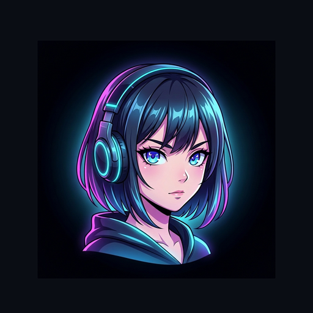

<div align="center">
  
  <h1>Tatap</h1>
  <p>Pemutar dan agregator anime mandiri multiplatform (Android Mobile, Android TV, Windows, Linux, Web) yang ringan, bebas iklan, tanpa registrasi akun, dan menjaga privasi data di penyimpanan lokal.</p>

  <p>
    <a href="https://github.com/asfaraguest/tatap/releases/latest"></a>
    <a href="https://github.com/asfaraguest/tatap/releases"></a>
    <a href="https://github.com/asfaraguest/tatap/stargazers"></a>
    <a href="https://github.com/asfaraguest/tatap/network/members"></a>
    <a href="https://hits.sh/github.com/asfaraguest/tatap/"></a>
    <a href="LICENSE"></a>
  </p>

  <p>
    <a href="https://trakteer.id/bagus_azizul" target="_blank"></a>
    <a href="https://ko-fi.com/L5J028GNTA" target="_blank"></a>
  </p>
</div>

---

## Fitur

- Bebas Iklan & Tanpa Akun: Akses streaming langsung tanpa pelacak atau registrasi.
- Antarmuka & Pemutar: Mendukung Ambient Stage Light, filter CRT scanline, dan penyesuaian rasio layar.
- Subtitle Bahasa Indonesia: Subtitle bawaan, terjemahan cepat AIGTX (500+ istilah anime), dan opsi integrasi AI (Gemini, Groq, OpenAI, Ollama).
- DPI-Bypass Terintegrasi: Modul TLS desync untuk membuka blokir akses stream tanpa VPN pihak ketiga.
- Privasi Lokal: Riwayat tontonan dan bookmark tersimpan di SQLite lokal (`anime.db`).

---

## Unduh dan Instalasi

### Unduhan Langsung Versi Terbaru

Pilih paket instalasi sesuai dengan sistem operasi dan perangkat Anda:

| Platform Perangkat | Tombol Unduh Langsung | Format Berkas | Keterangan & Kompatibilitas |
| :--- | :---: | :---: | :--- |
| **Android Ponsel / Tablet** | [](https://github.com/asfaraguest/tatap/releases/latest/download/tatap-release-v2.7.0.apk) | `.apk` (~35 MB) | Ponsel dan tablet (Android 7.0 s/d 16, layar sentuh) |
| **Android TV / Google TV** | [](https://github.com/asfaraguest/tatap/releases/latest/download/tatap-tv-release-v2.7.0.apk) | `.apk` (~35 MB) | Khusus Android TV (antarmuka Leanback dan remote D-pad) |
| **Windows (x64)** | [](https://github.com/asfaraguest/tatap/releases/latest/download/tatap-windows-x64-portable.zip) | `.zip` (~26 MB) | Standalone Portable (Ekstrak zip dan jalankan `Tatap.exe`) |
| **Linux (x86_64)** | [](https://github.com/asfaraguest/tatap/releases/latest/download/Tatap-x86_64.AppImage) | `.AppImage` (~58 MB) | Standalone AppImage (Berikan izin `chmod +x` dan jalankan) |

Seluruh arsip versi rilis sebelumnya tersedia di [Halaman Rilis GitHub](https://github.com/asfaraguest/tatap/releases).

### Panduan Tambahan

#### Android & Android TV
Unduh berkas APK sesuai tipe perangkat Anda dari tabel di atas atau [GitHub Releases](https://github.com/asfaraguest/tatap/releases), kemudian pasang pada perangkat (Android 7.0+).
- **Android TV:** Gunakan `tatap-tv-release-v*.apk` (dioptimalkan untuk navigasi remote D-pad dan antarmuka Leanback).
- **Android Ponsel / Tablet:** Gunakan `tatap-release-v*.apk` (dioptimalkan untuk orientasi layar sentuh).

#### Windows
1. Unduh arsip zip portable melalui tombol unduh di atas.
2. Ekstrak arsip ke folder mana pun, lalu jalankan `Tatap.exe` (menggunakan Edge WebView2 bawaan Windows).

#### Linux

**AppImage:**
```bash
chmod +x Tatap-x86_64.AppImage
./Tatap-x86_64.AppImage
```

**Dari Source Code:**
```bash
git clone https://github.com/asfaraguest/tatap.git
cd tatap
./install.sh
./manage.sh start
```
Buka peramban di `http://127.0.0.1:8767`. Untuk menghentikan server: `./manage.sh stop`.

---

## Pintasan Keyboard (Desktop)

| Tombol | Fungsi |
| :--- | :--- |
| `Spasi` / `K` | Putar / Jeda |
| `F` | Layar penuh |
| `←` / `→` | Mundur / Maju 5 detik |
| `J` / `L` | Mundur / Maju 10 detik |
| `↑` / `↓` | Atur volume |
| `M` | Matikan suara (Mute) |
| `[` / `]` | Perlambat / Percepat kecepatan putar (0.5x - 2.0x) |
| `C` | Aktifkan filter CRT |
| `Esc` | Keluar layar penuh / Batalkan dialog |

---

## Navigasi Remote (Android TV)

Tatap TV dirancang khusus agar dapat dioperasikan penuh menggunakan remote kontrol D-pad:

| Tombol Remote | Fungsi di Layar Utama & Daftar Anime | Fungsi Saat Pemutaran Video (Player) |
| :--- | :--- | :--- |
| `D-Pad Kiri / Kanan` | Berpindah antar item / kartu episode | Mundur / Maju 5 detik (Seek) |
| `D-Pad Atas` | Berpindah ke baris atas / bar pencarian | Memunculkan menu atas (Resolusi, Subtitle, Info) |
| `D-Pad Bawah` | Berpindah ke baris bawah / konten | Menyembunyikan menu atas / toggle kontrol player |
| `D-Pad Tengah` / `OK` | Membuka detail / mulai memutar | Putar / Jeda (Play / Pause) / Lewati Opening |
| `Menu` / `Info` / `Settings` | Buka menu navigasi drawer | Buka dialog pengaturan resolusi, subtitle, dan rasio |
| `Play / Pause` | – | Putar / Jeda video secara langsung |
| `Rewind` / `Fast Forward` | – | Mundur / Maju 5 detik |
| `Next` / `Previous` | – | Pindah ke episode berikutnya / sebelumnya |
| `Kembali` / `Back` | Kembali ke halaman sebelumnya / tutup dialog | Sembunyikan kontrol player / kembali ke daftar episode |

---

## Konfigurasi AI Subtitle (Opsional)

Dukungan model bahasa kustom (BYOK) via kolom pencarian pemutar:

| Perintah | Layanan |
| :--- | :--- |
| `:gemini <api_key>` | Google AI Studio |
| `:groq <api_key>` | Groq Cloud |
| `:openai <api_key>` | OpenAI |
| `:ollama <api_key>` | Ollama |

Perintah utilitas:
- Cek kunci: `:apikey`
- Hapus kunci: `:apikey clear`
- Ganti model: `:model <nama_model>`

---

## Dukungan dan Donasi

Jika Anda merasa aplikasi ini bermanfaat, dukung pengembangan Tatap agar tetap aktif, bebas iklan, dan terus diperbarui:

<p align="left">
  <a href="https://trakteer.id/bagus_azizul" target="_blank">
    
  </a>
  &nbsp;
  <a href="https://ko-fi.com/L5J028GNTA" target="_blank">
    
  </a>
</p>

---

## Riwayat Versi & Changelog

Proyek ini sepenuhnya mematuhi kaidah [Semantic Versioning 2.0.0](https://semver.org/lang/id/). Catatan riwayat perubahan terperinci dan alasan kenaikan tiap nomor versi didokumentasikan di [CHANGELOG.md](CHANGELOG.md).

---

## Batasan Layanan

- Memerlukan koneksi internet aktif untuk mengambil metadata dan memutar stream.
- Aplikasi bertindak sebagai agregator konten publik dan tidak menyimpan video pada server tersendiri.
- Lisensi di bawah [GPL-3.0](LICENSE).
